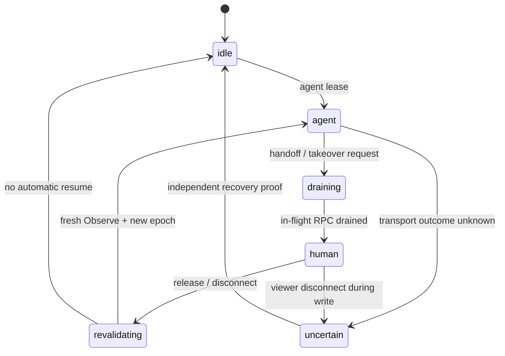

# AndroidController M4 详细调研（2026-11-05）

> 本文是 M4 的研究结论与准入门槛。它描述当前源码、离线测试和固定版本外部资料所能证明的范围，不把规划中的接口写成已交付能力。当前没有授权在线 ADB 设备，所有真实弹窗、viewer 控制、双设备实机隔离和虚拟显示探针均为 `NOT_RUN`。

## 结论先行

M4 不是一个“把 scrcpy 的 `control` 改成 `true`”的单点功能，而是三层边界：

1. **交还（M4.0）**：已经有可用的宿主可信回执。它能在同一次 `ExecuteStep`/序列调用内暂停，用户选择继续或停止；继续不会重放已完成步骤，停止、取消和超时都会让旧观察凭据失效。它还没有持久断点、独立 takeover 控制面或真实宿主对话框验证。
2. **接管（M4.1）**：尚未交付。viewer 目前是只读帧流；直接打开 scrcpy 控制通道会绕过现有租约、预算、验证和风险策略，必须先建立统一的设备操作所有权状态机。
3. **多设备与隔离（M4.2/M4.3）**：ADB 传输层已经按 serial 并行、按 serial FIFO，并支持全局管理屏障；任务层仍以一次调用的设备租约为边界，不能把“ADB 可以并行”误写成“多个任务可以共享同一设备”。跨设备序列的凭据和步骤覆盖已有拒绝逻辑，但设备别名、外部 ADB 客户端和跨显示 session 身份仍未闭合。
4. **后台虚拟屏（M4.5）**：没有实现。scrcpy v5.0.1 的 server 静态源码确实支持 `new_display`、控制 socket 和虚拟屏触控，但仓库没有把这些接入 FrameHub、UI 证据、viewer 或统一回执。虚拟屏必须先过真实设备探针，尤其是任务迁移、焦点、IME/剪贴板和显示 ID 映射。

M4 的主线建议是：**先把 M4.0 的交还语义固定为统一 ownership 基础，再做 M4.1 的人类输入；M4.2 保留现有队列并补契约，M4.3 补身份边界；M4.5 独立评估，不阻塞没有虚拟屏需求的 M5。**

## 证据范围与可复现性

本轮离线测试共 **319/319 pass，0 fail/cancel/skip，exit 0**，耗时约 4.10 秒。测试覆盖 human interaction、system injection、ADB scheduling/budget、step runtime、sequence/frame context、display security/start review、stream/scrcpy lifecycle 和 distributed cancellation；它们使用 mock/harness，不等于真机或真实 Electron UI 通过。原始命令、退出码和日志在 [offline-tests.json](../../artifacts/android-m4-research-2026-11-05/offline-tests.json) 与 [offline-tests.log](../../artifacts/android-m4-research-2026-11-05/offline-tests.log)。

设备探针使用 `D:\AI\tools\platform-tools\adb.exe devices -l`，exit 0，但输出只有 `List of devices attached`，授权在线设备为 0，`serviceInitialized=false`；见 [device-status.json](../../artifacts/android-m4-research-2026-11-05/device-status.json)。因此本报告不声称 M4 的真机通过。

外部静态依据固定为 scrcpy `v5.0.1`（tag commit `a60891aea193d92e7e5c3942700eca63f9d19a5f`）和 AOSP `android-16.0.0_r1`，下载内容、URL 和 SHA-256 在 [source-manifest.json](../../artifacts/android-m4-research-2026-11-05/source-manifest.json)。源码只证明实现和协议形状，不能替代目标 ROM 的运行结果。

## M4.0：Handoff 已有可交付内核，但不是 takeover

### 当前调用路径

`AndroidControllerService.js` 的 `handoff()` 只接受 `reason` 和绑定设备。调用前后会使 `contextTracker` epoch 增长并清掉 `lastObserve`/`lastVision`；它通过主进程注入的 `humanInteraction` 请求可信宿主服务，返回用户选择。`processToolCall` 对包含 Handoff 的调用采用最多 600000ms 的总预算，仍共享同一个 `step-runtime` 设备租约。

主进程服务使用 Electron `dialog.showMessageBox(parentWindow, ...)`，按钮只有“停止/继续”，默认是停止；消息要求用户在手机上处理。它是宿主原生对话框，不能由模型参数伪造，但它挂在主窗口上且是 modal。真实 Electron 窗口和手机操作未在本轮运行。

### 已证明的语义

- Handoff 继续是在**同一个调用和序列**中恢复，已完成的步骤不重放；中间步骤仍要求独立 `expect`。
- Handoff 期间同 serial 的另一个写操作收到 `DEVICE_BUSY`；租约直到底层在途操作实际结束才释放。
- 停止、宿主取消、超时和迟到的“继续”都不能恢复旧调用；旧 `snapshotId`/`frameId` 必须重新 Observe。
- `unknown` 不会被改写成成功，也不会自动重放。

这些行为由 [android-human-interaction.test.js](../../tests/android-human-interaction.test.js)、[android-sequence-contract.test.js](../../tests/android-sequence-contract.test.js) 和 [step-runtime.js](../../VCPDistributedServer/Plugin/AndroidController/lib/step-runtime.js) 支撑。

### 尚未覆盖

M4.0 仍缺少持久 resume token、跨请求恢复、独立的用户接管控制面、物理触摸检测和“用户操作期间绝不自动恢复”的设备侧证明。它只适合作为“请人处理后继续/停止”的同步步骤，不应被宣传为 viewer takeover。

## M4.1：viewer 人类接管的真实缺口

### 当前形状

`scrcpy-hub.js` 启动 server 时硬编码 `audio=false control=false cleanup=false`。`stream-server.js` 的 WebSocket 只处理 `ping`、`request-jpeg`、`request-keyframe`、`stats`；HTTP 只有帧、状态、设备发现/连接和 scrcpy 生命周期接口。现有 loopback、Same-Origin、HttpOnly/SameSite cookie 检查保护的是 viewer 读流/session，**不是人类写入的设备所有权**。

因此接管不能直接做成“把 control 改 true”或“在 WS 中转 pointer”。scrcpy 的控制 socket 是双向自定义二进制协议；v5.0.1 的 `ControlMessageReader` 按消息类型解析可变长度字段，触摸/按键/滚动路径没有通用的执行 ACK。设备侧只为剪贴板序列提供 `AckClipboard`。写入 socket 只能证明“已派发到传输层”，不能独立证明目标窗口已经完成动作。

### 建议的 ownership 状态机

每个 serial 维护一个 ownership epoch。Agent 的 snapshot/frame 凭据绑定 epoch；人类开始接管时先阻止新写入、等待在途 RPC 排干，再递增 epoch 并让 viewer 获得写 lease。人类结束、viewer 断开或 session 失效时不自动恢复旧 Agent 动作，必须重新 Observe；在途结局未知时设备进入隔离，沿用现有 `DEVICE_STATE_UNCERTAIN`/恢复证明语义。

### 交付顺序

- **M4.1a：统一写入仲裁**。把 Agent、Handoff、viewer、未来 Jev 连续执行器都纳入同一 serial ownership；读流 session 不能隐式获得写权限。
- **M4.1b：最小控制面**。优先支持有限的 tap/key/swipe/scroll 消息，经现有 lease、预算、取消和 `dispatched/unknown` 回执；不先承诺完整低延迟鼠标轨迹。
- **M4.1c：viewer session**。建立显式 start/end takeover、session token、ownership epoch、断开处理和 stale credential 拒绝；控制通道只接受 loopback/同源且有效写 session。
- **M4.1d：低延迟 scrcpy 控制**。仅在最小控制面通过后接入连续 pointer；必须处理按下未抬起、控制 socket 断开和无 ACK 的 unknown。

验收必须同时包含 Agent 写入被拒、session 断开不自动恢复、旧 frame/snapshot 失效、同 serial 仍只有一个 owner、在途写排干和未知结果隔离。路线图中的 `tests/android-takeover-lease.test.js` 目前不存在，应视为计划中的测试锚点。

## M4.2：传输队列已经实现，任务租约要分开看

实际类名是 `AdbCommandQueue`，不是路线图旧描述的 `Map<serial, SerialQueue>`。它使用一个全局容量（默认 64，包含 active/pending），每个非空 key 按设备串行；不同 serial 可以并行；`null` key 是跨所有设备的 FIFO 全局屏障。排队取消/超时会移除 pending 项；运行中取消会保留 key，直到传输真正 settle，再释放后续任务。

`adb.js` 的 scheduling key 为实际 serial；无 selector 的 `devices`/`version`/特定 mdns 读使用 host-read key；其它全局或未绑定命令使用 null 屏障。参数在入队时复制并绑定 deadline/signal。`tests/adb-device-scheduling.test.js` 已覆盖 A 阻塞时 B 继续、同设备 FIFO、host read、全局屏障、公平性、取消/超时、全局容量、key 归一化和真实 Service Observe B 穿过 A 阻塞。

这里有两个不能混为一谈的层次：

- **传输调度**：允许不同设备的 ADB 子进程并行。
- **任务所有权**：`step-runtime` 的 `leases` 仍会拒绝同 serial 的第二个高层操作，返回 `DEVICE_BUSY`；它不会把两个 Agent 任务排成安全的业务序列。

M4.2 的剩余工作是补公开状态和文档契约，而不是重写队列：暴露 queue depth/active key/unknown 状态的诊断，明确 USB serial 与 Wi-Fi 地址是不同 key，必要时建立同一物理设备的 canonical identity。两个独立主机上的 ADB 客户端也不受此进程内队列保护，不能声称全局互斥。

## M4.3：跨设备边界已有基础，缺的是身份闭合

当前 `executeSequence` 禁止步骤覆盖 `serial/device/deviceSerial`，禁止 `System`，后续步骤禁止复用 `index/snapshotId/frameId/x/y/...` 等未来凭据；中间步骤必须有 `expect`，每步在同一个高层 lease 下重新定位和验证。`step-runtime.bindDevice()` 在 `__auto__` 解析出物理 serial 后会追加租约，同一 serial 冲突会拒绝。

这些规则足以防住最危险的“序列中途换 serial”与“跨设备复用坐标/索引”，但还没有完成：

- USB serial、Wi-Fi/IP serial、mDNS 名称到物理设备的 canonical mapping；
- display/session 维度的凭据 key（当前 `lastObserve`/`lastVision` 和 context tracker 主要按 serial）；
- 外部 ADB 客户端或另一个宿主进程的互斥；
- 对外稳定、细分的跨设备错误码（目前部分路径仍是 `INVALID_ARGUMENT` 或普通错误）。

M4.3 应以验收矩阵收口：设备 serial 变化、别名变化、断线重连、旧凭据、序列中途设备变化、不同设备并行以及不确定结局恢复。它不要求重复实现已有队列。

## M4.5：虚拟显示可行，但当前产品链路尚未成立

### 外部能力与关键修正

scrcpy v5.0.1 的官方文档支持 `--new-display=WxH/dpi`、`--start-app`、`--keep-active`、`--display-ime-policy` 和默认销毁内容。server 在 Android 10+ 以 `DisplayManager.createVirtualDisplay` 创建显示，带 `OWN_CONTENT_ONLY`、`SUPPORTS_TOUCH` 等 flags；Android 13/14 还会增加 trusted/own focus 等 flags。`Controller` 对独立 new display 会等待虚拟 display id，并把触控坐标映射到它，按键使用目标 display；但 `power_on` 和 clipboard autosync 默认值在 Options 中是 true，必须由宿主显式关闭或按策略授权。

scrcpy 的 `tunnel_forward=true` 会依次等待 video/audio/control socket 连接；只启动 server 而不连接 video socket，不能据此断言虚拟屏已经完成采集初始化。仓库当前启动的是 video-only、control=false 会话，尚未接入 new display 参数。

两个显示 ID 命名空间也不能直接混用：AOSP `screencap -d` 的说明指向 SurfaceFlinger 有效 display ID，而 `dumpsys window`/任务窗口中的 `mDisplayId` 是逻辑 display ID。必须先建立映射并在回执中保留 namespace/generation，不能盲把逻辑整数传给 `screencap`。

UiAutomation 的 AOSP 实现中，按 display 的 `getWindows()` 使用内部 display 绑定，直接带 displayId 的构造函数是 private；公开能力还包括 `getWindowsOnAllDisplays()`，而 `getRootInActiveWindow()` 仍是全局 active root。承运 uiautomator RPC 目前固定 `dumpWindowHierarchy(compressed,maxDepth,rootInActive)` 三参，XML root 也不提供完整 windowId/type/layer/occlusion，因此“加第四个 display 参数”必须用真实 RPC 探针确认，不能从字符串或 APK 类名推断已支持。

### P0 探针（设备在线后按序执行）

1. **显示清单与命名空间**：采集 `dumpsys display`、`dumpsys SurfaceFlinger --display-id`、`dumpsys window displays`，建立 logical ↔ SurfaceFlinger 映射和 generation。
2. **overlay 副屏隔离**：建一个可控副屏，分别验证截图非黑、`input -d` 点击只在副屏生效、物理屏焦点和用户操作保持不变；三项任何一项失败就停止后台写入路线。
3. **感知能力**：用承运 JSON-RPC 探测第四参数和多 root 返回，确认 XML 中目标包与 display 元数据；没有独立窗口身份就只能声明 vision 坐标能力。
4. **scrcpy new display**：接收真实 video socket 后验证建屏日志、首帧、`start-app`、控制 socket 和关闭清理；分别测试 Android 10–12、13–14/更高版本行为。
5. **任务与焦点矩阵**：冷启动、前台已有任务、后台任务、不同 App/同 App、singleTask/multiple-task；记录任务是否被迁移、物理屏 focus、IME 显示位置和权限弹窗落点。
6. **稳定性**：建屏→启动→Observe→动作→停止循环至少 20 次；display 数字 ID 允许变化，要求 generation 显式变化且无残留显示/窗口/租约。

### 实现分层

- P1：`DisplayTarget` 和按 display 分域的 context/frame/snapshot 凭据；默认屏行为保持不变。
- P2：FrameHub/ScrcpyHub/stream-server 一 display 一 session，支持 `display_id`/`new_display` 和显示切换。
- P3：先用 `cmd input -d` 做实验性兜底，只能回报 `dispatched`；不能伪造 `verified`。
- P4：根据探针选择承运 RPC display 参数或 scrcpy control；仍走同一 lease/预算/回执。
- P5：显式人类授权、双屏只读镜像、能力声明和风险策略。

硬约束：目标 display 与焦点 display 不一致时禁止 `KEYCODE_PASTE`/剪贴板 IME 路径；系统权限弹窗不能证明用户可见，最多 `dispatched`；`AUTO_WAKE` 不能无条件点亮物理屏；默认关闭后台写入能力；不引入 root/Shizuku 作为隐含前提。

M4.5 不依赖 M3 的 OCR。它依赖 M2.5 的上下文/身份和 M2.6 的动作策略、租约、回执；若只做坐标视觉，不能补写语义树缺失。M3 只在需要 OCR/视觉候选时成为可选能力。

## 与 M5 连续执行和 Skill 的关系

用户提出的“主模型只提供意图，Jev 在宿主内判断下一步，成功后总结 Skill，之后连续执行并对页面变化自适应”可以建立在 M4 的 ownership 基础上，但不是 M4 的替代物：

- M5 执行器需要持有跨模型等待、批次和重观察的**任务租约**；只依赖一次 tool call 的 lease 会在 Jev 等待时泄漏并发写入。
- Jev 只能从当前观察和动作白名单产生候选；每步仍由 AndroidController 独立定位、派发、验证，不能把模型自报成功当完成。
- Skill 保存的是语义目标、参数引用、前后置条件和版本化步骤图，不能保存旧 snapshot/frame/绝对坐标或历史批准。
- 页面变化时先重新观察和重定位；只有局部语义变化才允许有界 Jev 修复，流程分支/目标变化要升级主模型或 Handoff。未知在途写不能重放。
- M5 的语义树路径不依赖 M3；OCR/视觉候选、M4.0 人类交还、M4.5 虚拟屏分别是按任务选择的可选依赖。

## 建议路线图与停止条件

| 顺序 | 工作 | 进入条件 | 停止条件 |
| --- | --- | --- | --- |
| M4.0 收口 | 记录真实 Electron dialog、Handoff 超时/断开和恢复语义 | 有授权设备与固定宿主 fixture | 迟到继续可能恢复旧任务、凭据未失效 |
| M4.2/M4.3 | 队列诊断、canonical identity、跨设备/别名/unknown 矩阵 | 现有离线契约保持 319/319 或完整回归绿 | 设备别名可绕过互斥或序列可换设备 |
| M4.1a–c | ownership epoch、接管 lease、有限控制消息、viewer session | M4.0 语义固定 | viewer 写入绕过 lease、断开自动恢复、无独立完成证据 |
| M4.1d | 连续 pointer/scrcpy control | 最小控制面和断线 unknown 已验收 | 无法排干按下状态或把 socket 写当 verified |
| M4.5 P0 | 显示映射、任务/焦点/IME/权限探针 | 授权在线设备和可复现实验 App | 三判据任一失败、任务迁移破坏用户前台、无法唯一识别目标 display |
| M4.5 P1–P5 | DisplayTarget、双流、按 display 注入/感知 | P0 全绿且明确 Android/OEM 范围 | 默认屏回归、跨屏凭据复用、焦点串屏、清理残留 |
| M5 | 意图执行、轨迹、Skill、适配 | M2.5/M2.6 与任务租约 | 候选不可验证、unknown 重放、Skill 依赖旧句柄 |

## 参考源

- 仓库：`VCPDistributedServer/Plugin/AndroidController/AndroidControllerService.js`、`lib/step-runtime.js`、`lib/adb-queue.js`、`lib/adb.js`、`lib/context.js`、`lib/stream-server.js`、`lib/scrcpy-hub.js`。
- 测试：[android-human-interaction.test.js](../../tests/android-human-interaction.test.js)、[adb-device-scheduling.test.js](../../tests/adb-device-scheduling.test.js)、[android-sequence-contract.test.js](../../tests/android-sequence-contract.test.js)、[android-frame-context.test.js](../../tests/android-frame-context.test.js)、[android-display-security.test.js](../../tests/android-display-security.test.js)。
- 固定外部源码：[source manifest](../../artifacts/android-m4-research-2026-11-05/source-manifest.json)，包括 scrcpy `Controller`/`ControlMessageReader`/`DesktopConnection`/`NewDisplayCapture`/`Options` 与 AOSP `screencap`/`InputShellCommand`/`UiAutomation`。
- 路线图：[android-controller-roadmap.md](android-controller-roadmap.md)；虚拟屏历史可行性记录：[android-virtual-display-feasibility.md](android-virtual-display-feasibility.md)。
